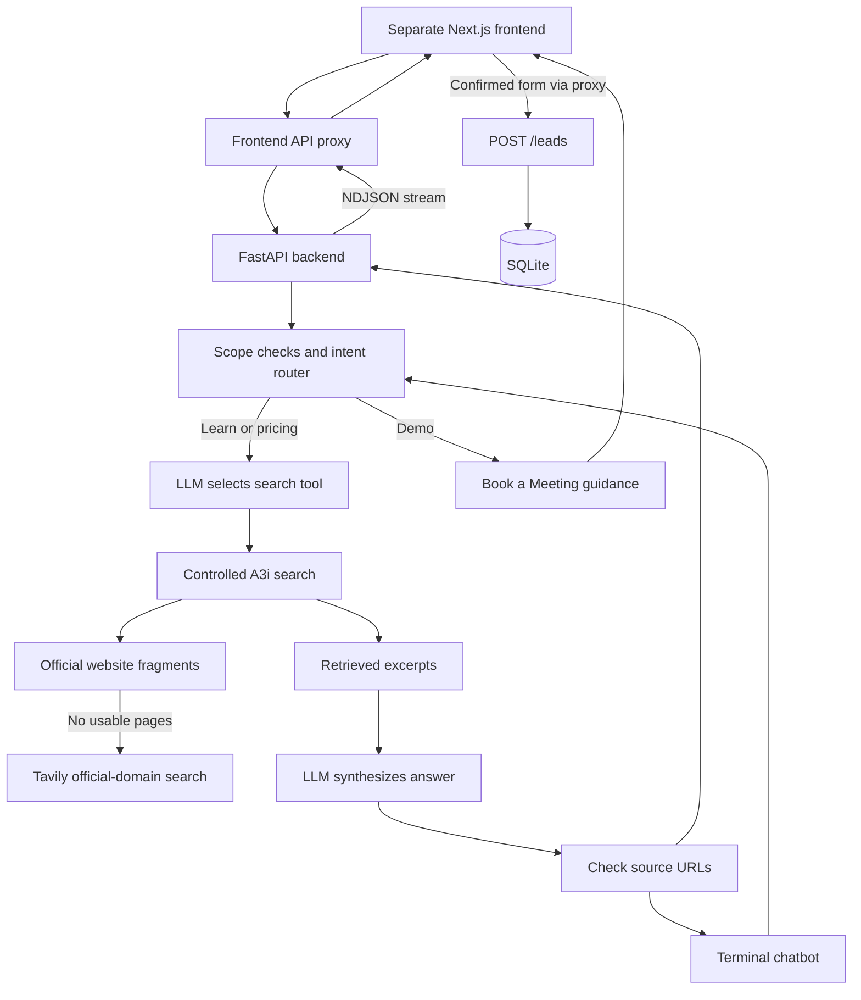

# a31-assistance

An A3i-Accel website assistant built with **Python, FastAPI, Groq, Ollama, and Tavily**. It answers A3i questions using retrieved evidence, handles pricing enquiries, and directs visitors to a demo request form.

This repository contains the **Python backend and terminal chatbot**. The React/Next.js frontend runs separately.

## What it does

- Retrieves official A3i website content before generating factual answers.
- Routes requests into **learn**, **pricing**, or **demo**.
- Uses the workflow **LLM → Tool → Result → LLM** for knowledge questions.
- Streams answers and remembers recent messages within a session.
- Labels partial product lists as examples and keeps features attached to their product and pricing tier.
- Suggests contacting A3i when pricing cannot be verified.
- Rejects unrelated requests and checks generated links against retrieved URLs.
- Stores confirmed demo requests in SQLite with protection against duplicate submissions.

The model is not fine-tuned on the question datasets. It retrieves evidence at runtime; prompts guide its answers but do not guarantee factual accuracy.

## Architecture

One primary LLM workflow handles knowledge questions. Small Python functions handle routing, greetings, clarification, demo guidance, and standard refusals. There are no separate autonomous agents for these tasks.



### Answer flow

1. Check the request's scope, resolve follow-ups, and ask for clarification when needed.
2. Return simple greetings, refusals, or demo guidance directly.
   General pricing questions without a clear product, service, or page context ask for clarification before searching. A product selected in reply retains the original pricing question. Prices for differently named products are not interchangeable without explicit source evidence.
   Ask "Show pricing for all products" (or answer a pricing clarification with "all of them") for a catalog pricing overview. This reads the homepage and all pages marked `product` in `website_sources.json`, rather than only two pages. The answer instructions request a sourced table, including unverified pricing, without the normal 60-word limit. Coverage depends on the catalog and successfully retrieved pages; it is not a guarantee of every current product.
   Named-product retrieval prioritizes its catalog product pages. Send3r uses its fixed official subdomain homepage and public demo/offer page, rather than AI-Marketing. Official navigation labels are preserved so answers can explain that NeXtory links to Notes AI and SpeedRec links to AI for Recruiters, while reporting plans under their published product names. Invenio follows the homepage/contact sources, not an assumed AI-Lead alias. Founding offers must retain eligibility and duration; unavailable prices must not be invented.
3. For knowledge questions, ask the LLM to call `search_a3i_web`.
4. Retrieve up to two relevant official pages from the fixed catalog in `website_sources.json`. Read their public HTML fragments and select relevant excerpts. If no pages are usable, or excerpts fail a keyword coverage check, try official-domain Tavily search when configured. CEO, COO, founder, and pricing questions require their respective terms in the excerpts to skip this fallback. This is a relevance heuristic, not proof that a page answers the question. Keep downloaded evidence if fallback search fails; external evidence still requires review and remains restricted to company-background questions.
5. Pass the evidence back to the LLM for its final answer. The shared final-answer instructions apply to both normal and streaming chat.
6. Remove generated URLs that were not retrieved. This validates link destinations, not whether every claim is supported.

**Models:** Groq is preferred when `GROQ_API_KEY` is configured; otherwise the backend uses Ollama. Groq failures can fall back to Ollama. After a Groq HTTP 429, the process observes a cooldown before trying Groq again. Ollama must be running and its model installed for that fallback to work.

**Memory:** Recent history is bounded and held in memory. API sessions expire after one hour of inactivity and disappear when the process restarts. Search results have a bounded 15-minute cache.

### Optional reviewed external evidence

Official A3i sources come first. Company-background questions may also use manually approved snapshots from the fixed external-source allowlist. Product features, pricing, policies, and demo queries remain official-only.

New external snapshots are `pending_review`. Pending or rejected text is never passed to the answer model. See [External source review](#external-source-review) below.

## Project structure

```text
Chatbot/
├── main.py                    FastAPI endpoints and development server launcher
├── agent.py                   Model selection, tool calls, prompts and streaming
├── router.py                  Learn / pricing / demo intent routing
├── conversation.py            Follow-up resolution and clarification
├── tools.py                   Search tool, excerpt selection and cache
├── website.py                 Official HTML-fragment reader
├── website_sources.json       Fixed source catalog and retrieval keywords
├── external_sources.py        External snapshot discovery and manual review
├── memory.py                  Bounded conversation history
├── leads.py                   Demo validation and SQLite storage
├── chat_cli.py                Interactive terminal chatbot
├── evaluate.py                Resumable live-answer evaluation
├── questions.json             100 supplied evaluation questions
├── benchmark_500.json         Supplied and generated evaluation scenarios
├── build_benchmark.py         Benchmark dataset generator
├── tests/                     Automated regression tests
├── data/                      Local databases and results; ignored by Git
├── DEPLOYMENT_SMOKE_REPORT.md Focused answer-check results and remaining issues
├── BENCHMARK_REPORT.md         Earlier benchmark findings
├── .env.example               Configuration template; no real keys
└── requirements.txt           Python dependencies
```

## Setup

Use **Python 3.10 or later**. Run the following in PowerShell:

```powershell
git clone https://github.com/shourya845/Chatbot.git
cd Chatbot
python -m venv .venv
.\.venv\Scripts\Activate.ps1
python -m pip install -r requirements.txt
Copy-Item .env.example .env
```

Copy `.env.example` only for a new setup. Do not overwrite an existing `.env` containing your configuration.

If PowerShell blocks activation, allow scripts for the current terminal session, then activate again:

```powershell
Set-ExecutionPolicy -Scope Process -ExecutionPolicy RemoteSigned
.\.venv\Scripts\Activate.ps1
```

### Environment variables

Edit your local `.env`:

```dotenv
GROQ_API_KEY=
GROQ_MODEL=openai/gpt-oss-20b
OLLAMA_URL=https://ollama.com
OLLAMA_MODEL=gpt-oss:20b
OLLAMA_API_KEY=
TAVILY_API_KEY=
```

| Variable | Purpose |
| --- | --- |
| `GROQ_API_KEY` | Enables the preferred cloud model. Leave empty to use Ollama. |
| `GROQ_MODEL` | Model name sent to Groq. |
| `OLLAMA_URL` | Ollama endpoint: `https://ollama.com` for cloud, or `http://127.0.0.1:11434` for local inference. |
| `OLLAMA_MODEL` | Exact cloud API model name or installed local model tag. |
| `OLLAMA_API_KEY` | Bearer authentication for Ollama Cloud. Leave empty for an unauthenticated local server. |
| `TAVILY_API_KEY` | Enables official-site fallback search and optional external discovery. Direct official-page retrieval works without it. |

For hosted deployment, set these variables in the backend host's environment too; your local `.env` is not deployed automatically. Ollama Cloud requires no local model installation.

For local inference, set `OLLAMA_URL=http://127.0.0.1:11434`, `OLLAMA_MODEL=qwen3:4b-instruct-2507-q4_K_M`, and leave `OLLAMA_API_KEY` empty. Install Ollama separately and pull the model:

```powershell
ollama pull qwen3:4b-instruct-2507-q4_K_M
```

Keep Ollama running. If its desktop service is not running, start it with `ollama serve` in another terminal. For a different installed model, update `OLLAMA_MODEL` accordingly.

Never commit `.env`, real credentials, or lead databases. Cloud and search services may have usage limits or charges; local inference requires sufficient hardware.

## Run the chatbot

### Backend for the website

From the **Chatbot repository root**:

```powershell
python main.py
```

The development API runs at `http://127.0.0.1:8000`. Open [interactive API documentation](http://127.0.0.1:8000/docs) to inspect and try the endpoints. There is no homepage handler at `/`.

Equivalent development command:

```powershell
python -m uvicorn main:app --reload --host 127.0.0.1 --port 8000
```

Leave this terminal open while using the frontend. Stop it with `Ctrl+C`.

### Terminal chat

```powershell
python chat_cli.py
```

For model/tool activity logs:

```powershell
python chat_cli.py --debug
```

Try `What are Apps, Ants and Agents?` or `What is NeXtory pricing?`. Type `bye` to exit.

The CLI calls the agent directly; it does **not** require the FastAPI server. Both need a working model provider and access to their evidence sources.

## Connect the frontend

In the separate Next.js frontend's server environment, set:

```dotenv
A3I_API_URL=http://127.0.0.1:8000
```

Start that frontend from its own directory:

```powershell
npm install
npm run dev
```

The existing frontend forwards `/api/chat` to backend `/chat/stream` and `/api/leads` to `/leads`. Preserve the returned session ID for follow-ups. Do not put model or search keys in `NEXT_PUBLIC_*` variables.

Backend CORS currently allows `http://localhost:3000` and `http://localhost:5173`. A browser connecting directly from another origin needs an appropriate CORS configuration; the existing server-side proxy does not depend on browser-to-backend CORS.

## API usage

| Endpoint | Purpose |
| --- | --- |
| `POST /chat` | Complete JSON answer with session ID and intent. |
| `POST /chat/stream` | NDJSON answer stream. |
| `POST /leads` | Validate and save a confirmed demo request. |

### Ask a question

```powershell
$body = @{ message = 'What is A3i-Accel?' } | ConvertTo-Json
$response = Invoke-RestMethod -Method Post -Uri 'http://127.0.0.1:8000/chat' -ContentType 'application/json' -Body $body
$response
```

The response contains `answer`, `session_id`, and `intent`. To continue the conversation:

```powershell
$body = @{
    message = 'What products does it offer?'
    session_id = $response.session_id
} | ConvertTo-Json
Invoke-RestMethod -Method Post -Uri 'http://127.0.0.1:8000/chat' -ContentType 'application/json' -Body $body
```

`page_path` is an optional frontend navigation hint such as `/products/ai-note`; it is not evidence. Omit `session_id` to start a new conversation. An expired or unknown supplied session returns HTTP 404.

### Streaming

Send the same request body to `/chat/stream`. Read each newline as a separate JSON event:

```json
{"type":"session","session_id":"...","intent":"learn"}
{"type":"delta","text":"A3i helps..."}
{"type":"done"}
```

Append `delta.text` to the displayed answer. An `error` event means the answer did not finish; a streaming HTTP 200 alone does not prove successful completion.

### Save a demo request

After the visitor confirms the form:

```powershell
$body = @{
    name = 'Demo User'
    company = 'Example Company'
    need = 'Explore meeting-note automation'
    confirmed = $true
    request_id = [guid]::NewGuid().ToString()
} | ConvertTo-Json
Invoke-RestMethod -Method Post -Uri 'http://127.0.0.1:8000/leads' -ContentType 'application/json' -Body $body
```

Success returns `lead_id` and `status: saved`. This example writes a synthetic lead to your local database. Reuse the same `request_id` when retrying the same submission; different details under an existing ID return HTTP 409.

Records are stored in `data/leads.sqlite3`. Saving a lead does **not** book a calendar appointment, send an email, or notify a sales team automatically.

### Request a meeting in terminal chat

Say `schedule a meeting for me` or `book a demo` in `python chat_cli.py`.
The terminal collects your name, company, contact email, discussion topic and optional preferred time.
Enter a preferred time with a timezone, for example `2026-12-01T15:00+05:30`, or leave it blank.
Review the details and type `yes` to save, or type `cancel` at any collection step.
Contact details are collected locally and are not added to model conversation history.
This saves a request only: no team notification or calendar invitation is sent, and the preferred time is not confirmed.

For an existing scheduling service, set `MEETING_BOOKING_URL` to your HTTPS booking-page URL in `.env`, then restart the chatbot/backend.
The terminal and website chatbot will direct visitors to that page to choose a time and complete booking.
The external booking service handles availability, confirmation and invitations.
Without this setting, website chat keeps its existing Book a Meeting form guidance.

`POST /leads` also accepts optional `email` and timezone-aware ISO `preferred_time` fields.
Existing form submissions remain compatible; the database gains these columns on the next save while retaining old records.

## Tests and answer evaluation

Run automated tests without making live model calls:

```powershell
python -m unittest discover -s tests -v
```

Run a small live evaluation separately:

```powershell
python evaluate.py --limit 10 --delay 20 --stop-on-quota
```

This uses real provider calls and saves answers, retrieved evidence, timings, and provisional review flags under `data/`. Check the answers against their evidence manually; a nonempty response is not necessarily correct.

For a larger JSON or CSV dataset:

```powershell
python evaluate.py --dataset benchmark_500.json --output data/benchmark_results.json --limit 10 --delay 60 --stop-on-quota
```

Add `--resume` to continue the same selected dataset and output. Saved IDs, including failures, are skipped; use a new output filename for a fresh evaluation after code changes. CSV input uses `ID,Category,Question` columns. Standalone questions have no invented conversation history.

HTTP 429 can still occur despite pacing. Groq cooldown is process-local; multiple CLI/API/evaluation processes can share the same provider quota. `--stop-on-quota` stops after a saved attempt reports exhausted quota/credits or authentication failure; temporary rate limits are recorded separately. Evaluation cancellation can take longer than its requested timeout.

See [deployment smoke results](DEPLOYMENT_SMOKE_REPORT.md) and [benchmark findings](BENCHMARK_REPORT.md). These reports describe limited checks, not an overall accuracy guarantee.

## External source review

External discovery is optional and requires Tavily. Collect company-background candidates and inspect their exact saved text:

```powershell
python external_sources.py collect "A3i-Accel company background"
python external_sources.py list
```

Verify the publisher, company identity, facts, and dates before approving a snapshot:

```powershell
python external_sources.py approve 1
```

Replace `1` with the ID shown by `list`. Reject or revoke a snapshot with:

```powershell
python external_sources.py reject 1
```

The allowlist covers restricted A3i LinkedIn URLs and relevant Wikipedia, NVIDIA, and Anthropic pages. Inclusion does not imply a matching article exists or that a candidate is accurate. Discovery uses public text returned by Tavily, not logged-in account access. Reviews are stored locally in `data/external_sources.sqlite3`; they are not uploaded through Git.

## Deployment

Deploy the frontend and backend separately:

1. Host the Python API on a service that supports a long-running Python process.
2. Install dependencies with `pip install -r requirements.txt`.
3. Start Uvicorn on the host's assigned port. For a Linux host providing `PORT`:

   ```bash
   uvicorn main:app --host 0.0.0.0 --port "$PORT"
   ```

4. Set backend credentials through the hosting service's environment settings.
5. Set the frontend's `A3I_API_URL` to the deployed backend's HTTPS address and redeploy the frontend.
6. Use persistent storage for `data/` if lead records and source approvals must survive restarts/redeployments.
7. Verify deployed chat streaming, pricing guidance, refusal behavior, and a demo submission end to end.

`python main.py` is a local development launcher with reload enabled. A cloud server cannot reach Ollama on your laptop through `127.0.0.1`; provide a reachable Ollama service for fallback or ensure the cloud model is available. The frontend's localhost default likewise cannot reach your laptop from a deployed server.

## Current limitations

- `product_catalog.json` stores the named products checked against the official homepage, with descriptions and linked pages. Update its verification date and entries when the website changes. Shared destinations are navigation links, not proof that two names are aliases. Complete-list requests use this catalog without model calls; individual Apps, Ants and Agents are outside its scope.
- Provider diagnostics record the model, error class, HTTP status and a safe failure category, never arbitrary provider error text. Empty responses try the next provider; Groq cooldown is shared by streaming and non-streaming calls within a process.
- Retrieval can miss pages or lose context. Update `website_sources.json` if the official website changes its fragments.
- Prompts and URL filtering are not semantic fact checking. Verbosity, citation formatting, and cross-product inference issues remain in the smoke report.
- Sessions, the search cache, provider cooldown, and request serialization are per process. Restarting clears memory; multiple workers do not share sessions.
- The API serializes chat generation within each process. A busy model returns a retry response.
- Lead endpoints do not include authentication or a complete public abuse-prevention layer. Assess those needs before exposing the service beyond an assignment demo.
- SQLite files need durable storage and appropriate access controls. They contain submitted lead information.

This project retrieves and synthesizes source content; it does not guarantee that every answer is correct or that every website page is covered.
